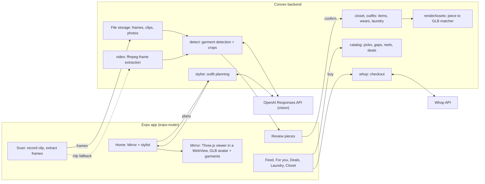

# Dripp

**Film your closet. Get dressed from what you own.**

People buy more clothes than ever and wear each piece less, and most fashion apps are built to sell you the next one. Dripp starts from the other end: record a short video of your clothes, confirm what it found, and get outfits styled on a 3D avatar from pieces already in your closet. When something really is missing, Dripp shows how it would work with what you have before you buy it.

## Why

- **One garbage truck of textiles is burned or sent to landfill every second**, and clothing utilisation (how many times a garment is worn before it is thrown away) fell 36% in 15 years. ([Ellen MacArthur Foundation, *A New Textiles Economy*, 2017](https://www.ellenmacarthurfoundation.org/a-new-textiles-economy))
- **The average person bought about 60% more garments in 2014 than in 2000, and kept each one about half as long.** ([McKinsey, *Style that's sustainable: A new fast-fashion formula*, 2016](https://www.mckinsey.com/capabilities/sustainability/our-insights/style-thats-sustainable-a-new-fast-fashion-formula))
- **11.3 million tons of textiles went to US landfills in 2018.** ([US EPA, Facts and Figures about Materials, Waste and Recycling: Textiles](https://www.epa.gov/facts-and-figures-about-materials-waste-and-recycling/textiles-material-specific-data))

Getting more wears out of what people already own is the cheapest fix, so that is what Dripp is built around.

## Features

- **Set up your mirror.** Onboarding asks for a body type and height, with an optional private full-body photo, and sets up the 3D avatar the Mirror dresses. You can skip and use a preset avatar.
- **Scan your closet.** Record a clip (or choose one from your library). The app pulls up to 10 frames on the device and uploads them; if that fails, Convex extracts frames from the video with ffmpeg. OpenAI vision finds each piece with its category, color and a cropped photo.
- **Review and confirm.** Edit the type and color of each detected piece, merge duplicates, reject misses, mark pieces private, then add them to your closet. A scan and its frames can be deleted.
- **Closet.** Every piece with its photo, filterable, with wear counts since the last wash. Start from a starter closet of everyday pieces, then add your scanned ones.
- **3D try-on.** Home shows today's look on a rotatable, zoomable avatar built from GLB garments. When you confirm a scan, a matcher maps each piece to a 3D garment by category, subtype, color family and pattern, only above 0.9 detection confidence; pieces without a match show as photos.
- **Stylist.** Tell Dripp your plans and it builds two looks from clean pieces in your closet, with a one-line reason for each. Lock a piece, change one slot or send a piece to the laundry and only that slot changes.
- **For you.** Dripp picks: pieces that work with what you own, each with **Why this fits your closet** listing the pieces it pairs with, plus the categories your closet is missing. Adding one copies it into your closet; nothing is bought.
- **Feed.** Full-screen reels of styled looks. Like, share, tap **Ask** to have the stylist rebuild the look from your closet on Home, or open **Shop this look** for the pieces in it.
- **Deals.** Brand deals with discounted products and a Whop checkout that opens in an in-app browser sheet, plus **Redeem code** for each brand's discount code.
- **Laundry and wears.** Confirm what you wore to log a wear. Pieces due for a wash are flagged, and pieces in the Laundry tab are left out of new looks until you mark them washed.
- **Profile.** Wears saved, day streak, the **One Piece, Three Ways** challenge (wear one piece in three different outfits) and points, 10 per logged wear.

## How it works

The app is Expo / React Native with expo-router. Everything with state or an API key lives in Convex: scans and detection, the closet, the stylist, the product catalog and reels, and Whop checkout. Every Convex function takes a closet code, and phones with the same code share one closet. OpenAI keys and the Whop key stay in the Convex environment and never ship in the app.



- **Detection.** `convex/detect.ts` sends the frames to the OpenAI Responses API and gets back each piece with category, subtype, color, pattern, a crop box and a confidence. Crops are cut with Jimp and saved as the piece's photo. `convex/describe.ts` adds a short descriptor (formality, warmth, summary) that the stylist reads.
- **Stylist.** `convex/stylist.ts` builds valid outfits from available pieces (no laundry, locked pieces kept), then asks the model to pick or compose two looks and give a reason for each. A single-slot change returns a swap so the Mirror only moves that garment.
- **Mirror.** `mirror-viewer/viewer.ts` is a Three.js scene bundled into `src/mirror/viewerHtml.generated.ts` and shown in a WebView (an iframe on web). Avatar and garment GLBs in `assets/mirror/` were baked from one body in one pose, so garments are added without skinning; `shared/renderAssets.ts` lists every garment key.
- **Checkout.** `convex/whop.ts` creates a Whop checkout for a catalog product at the deal price and returns its URL, which `src/lib/whop.ts` opens with `expo-web-browser`.

## Run it

Requires Node 22.13 or newer (React Native 0.88 supports `^22.13.0 || ^24.3.0 || >=26`).

```bash
npm install
cp .env.example .env.local   # then fill in the values below
npx expo start               # Expo Go, a dev client, or press w for web
```

Add packages with `npx expo install <package>` so versions match the Expo SDK.

**App environment** (`.env.local`, git-ignored; restart `npx expo start` after editing):

| Variable | What |
|---|---|
| `EXPO_PUBLIC_DATA_MODE` | `live` connects the app to Convex. Any other value runs on local in-memory data. |
| `EXPO_PUBLIC_CONVEX_URL` | Your Convex deployment URL. |
| `EXPO_PUBLIC_CLOSET_CODE` | The closet code: the only credential for a closet, shared out of band. Never commit it. |
| `EXPO_PUBLIC_MIRROR_AVATAR` | Optional. `b` uses the dressed avatar in the Mirror. |

**Convex environment** (set with `npx convex env set <NAME> <value>`, never in the app):

| Variable | What |
|---|---|
| `OPENAI_API_KEY` | Detection, body estimate, descriptors and the stylist. |
| `WHOP_API_KEY` | Whop checkout. |
| `WHOP_ENVIRONMENT` | Optional. `production` uses Whop's live API. |
| `DETECT_MODEL`, `DETECT_EFFORT`, `DETECT_DETAIL`, `OPENAI_STYLIST_MODEL`, `OPENAI_DESCRIBE_MODEL` | Optional model overrides. |

**iOS dev client.** Video frame extraction and the Mirror need native modules, so use a development build instead of Expo Go for the full app:

```bash
npx expo run:ios                                                         # local build with Xcode
npx eas-cli@latest build --profile development --platform ios            # or a cloud build for a physical iPhone
npx eas-cli@latest build --profile development-simulator --platform ios  # or for the iOS Simulator
npx expo start --dev-client
```

EAS builds do not read `.env.local`; add the `EXPO_PUBLIC_*` variables to the EAS `development` and `preview` environments with `npx eas-cli@latest env:create`.

**Backend.**

```bash
npm run convex:dev       # convex dev: watch and push to your dev deployment
npm run convex:deploy    # convex dev --once: push once
npx convex deploy        # push to the production deployment (uses CONVEX_DEPLOY_KEY)
```

**Checks.**

```bash
npm run typecheck            # app
npm run typecheck:convex     # backend
npm run lint
npm run test:convex          # vitest + convex-test for convex/
npm run build:mirror-viewer  # rebuild the Mirror viewer after editing mirror-viewer/
```

## Repo layout

| Path | Owner | What |
|---|---|---|
| `src/app/` | Aditya | expo-router screens. Tabs: Home, Feed, For you, Laundry, Closet, Deals. Onboarding, scan and review, and Profile (top corner) are stack screens. |
| `src/components/`, `src/constants/theme.ts` | Aditya | UI components and design tokens. |
| `src/components/Mirror.tsx`, `src/mirror/`, `mirror-viewer/`, `assets/mirror/` | Kenil | The 3D Mirror: React Native surface, Three.js viewer, avatar and garment GLBs. |
| `src/data/`, `src/lib/` | Aditya, Kenil | Data layer: Convex hooks and calls, clip-to-frames upload, Whop checkout. |
| `convex/` | Shresth | Convex backend: schema, scans, detection, closet, outfits, stylist, catalog, Whop, and their tests. |
| `shared/` | all | `contract.ts` (types shared by app and backend, import as `@shared/contract`) and `renderAssets.ts` (garment keys). |
| `fixtures/` | Shresth | A closet clip for exercising the scan pipeline. |
| `docs/` | all | Build plan and handoff notes. |

## Team

Aditya: app UI. Kenil: Mirror and 3D. Shresth: Convex backend.

## Rules

- No secrets in the repo. Keys stay in the Convex environment or in git-ignored `.env*.local` files.
- Change `shared/contract.ts` in its own small commit and tell the other owners.
